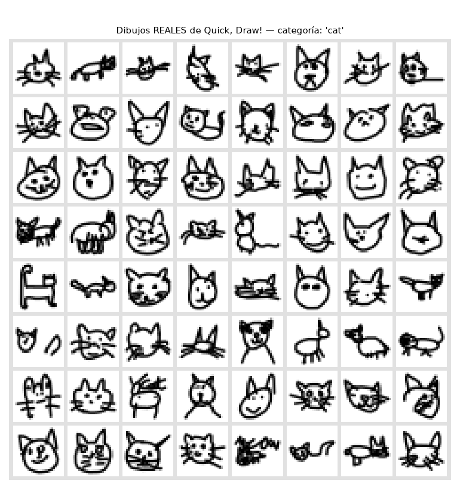
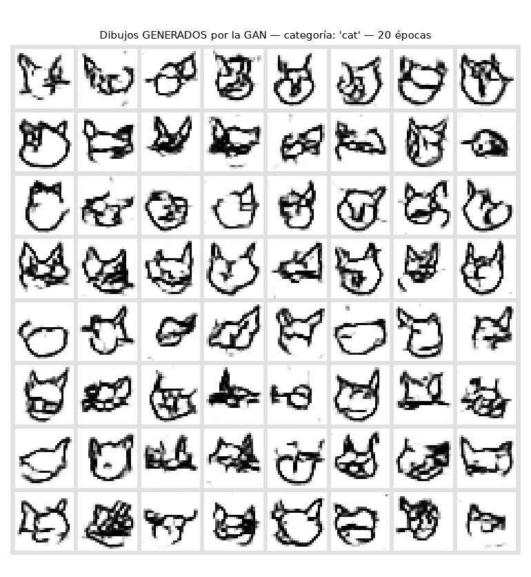
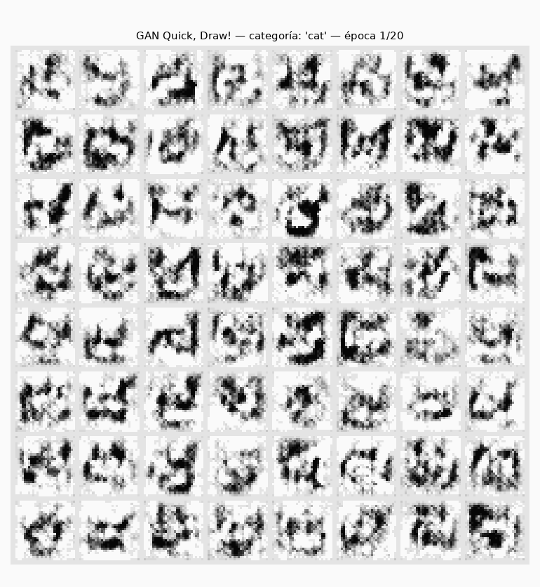
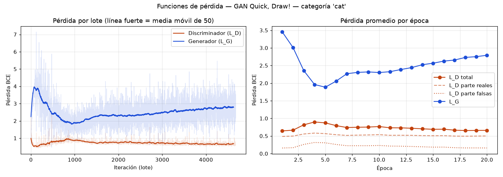
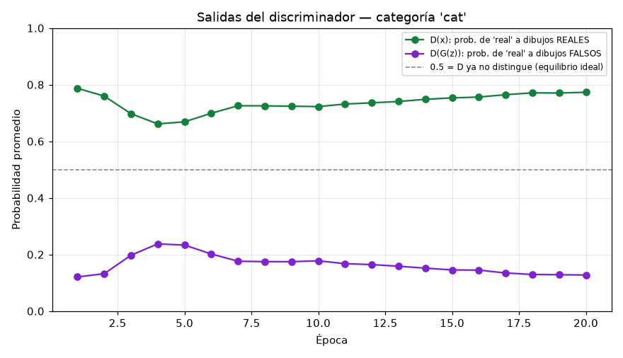
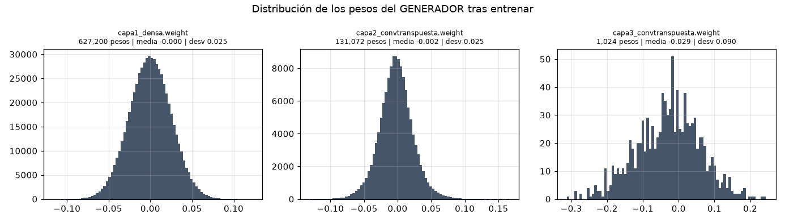
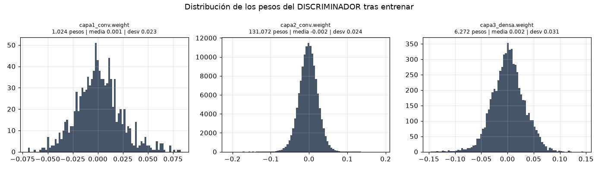

# GAN con Quick, Draw!

**Asignatura:** Inteligencia Artificial Generativa
**Autor:** Camilo Enrique Correa Barón
**Categoría usada:** `cat` (gato) — se puede cambiar con `--categoria`

Una **Red Generativa Adversaria (GAN)** de tipo DCGAN que aprende a dibujar gatos
a partir de los dibujos hechos a mano por personas en el juego *Quick, Draw!* de Google.
Dos redes compiten: el **Generador** dibuja gatos falsos a partir de ruido, y el
**Discriminador** intenta distinguirlos de los dibujos reales. Al competir, ambas mejoran.

---

## Resultados (categoría: `cat`, 20 épocas)

| Dibujos reales del dataset | Dibujos generados por la GAN |
|---|---|
|  |  |

**Evolución del generador época por época:**



**Funciones de pérdida y salidas del discriminador:**




**Pesos de las redes tras entrenar:**




Tablas de parámetros y valores de los pesos: [`01_arquitectura_y_parametros.txt`](resultados/cat/01_arquitectura_y_parametros.txt) · [`08_pesos_finales.txt`](resultados/cat/08_pesos_finales.txt) · [`historial_entrenamiento.csv`](resultados/cat/historial_entrenamiento.csv)

---

## 1. Estructura del proyecto

| Archivo | Qué contiene |
|---|---|
| `modelos.py` | **Aquí se crean las dos redes**: `class Generador` y `class Discriminador`, con cada capa comentada. También las funciones para ver parámetros y valores de los pesos. |
| `entrenamiento.py` | **Funciones de pérdida** (`perdida_discriminador`, `perdida_generador`) y el bucle de entrenamiento. |
| `datos.py` | Descarga y normalización del dataset Quick, Draw! |
| `visualizacion.py` | Cuadrículas de dibujos, curvas de pérdida, histogramas de pesos, GIF. |
| `main.py` | Programa principal. Las líneas marcadas `>>> AQUÍ SE CREA LA RED ... <<<` instancian cada red. |
| `generar.py` | Usa el generador ya entrenado para crear dibujos nuevos al instante. |
| `resultados/cat/` | Todo lo que produce el entrenamiento (ver sección 6). |

---

## 2. Paso a paso (Windows + PowerShell + uv)

**Requisitos:** tener `uv` instalado (`uv --version` para comprobar).

```powershell
# 1) Ir a la carpeta de proyectos
cd "D:\Proyectos Generativa"

# 2) Descomprimir el proyecto ahí (ajusta la ruta del zip si lo descargaste en otro lado)
Expand-Archive "$HOME\Downloads\gan-quickdraw.zip" -DestinationPath "D:\Proyectos Generativa"
cd gan-quickdraw

# 3) Crear el entorno e instalar dependencias (PyTorch pesa ~250 MB, tarda un poco)
uv sync

# 4) (Opcional) Abrir en VS Code
code .

# 5) Prueba rápida (~1-2 min) para verificar que todo funciona
uv run main.py --epocas 3 --imagenes 5000

# 6) Entrenamiento de verdad (~5-15 min en CPU)
uv run main.py

# 7) Generar dibujos nuevos con la red ya entrenada
uv run generar.py
uv run generar.py --interpolar
```

La primera vez descarga `data/cat.npy` (~100 MB). Las siguientes usa el archivo guardado.

**Otras categorías** (nombres en inglés, [lista oficial](https://github.com/googlecreativelab/quickdraw-dataset/blob/master/categories.txt)):
`uv run main.py --categoria apple` · `--categoria star` · `--categoria "smiley face"`.
Las formas simples (manzana, estrella, carita) se aprenden más rápido que un gato.

**GPU (opcional):** el código detecta solo si hay CUDA. Para usar una tarjeta NVIDIA,
descomenta el bloque marcado en `pyproject.toml` y corre `uv sync` otra vez. En CPU funciona igual, solo más lento.

---

## 3. El dataset: Quick, Draw!

*Quick, Draw!* es un juego de Google donde tienes 20 segundos para dibujar algo
mientras una IA intenta adivinarlo. Google liberó unos **50 millones de dibujos de 345 categorías**.
Usamos la versión `numpy_bitmap`: cada dibujo es una imagen de **28 × 28 píxeles** en gris (784 valores de 0 a 255).

Preprocesamiento (`datos.py`):
1. Se toman 30.000 dibujos al azar de la categoría (de ~120.000 que tiene `cat`).
2. Se normalizan de `[0, 255]` a **`[-1, 1]`**, porque el generador termina en `Tanh`, que produce ese rango.
3. Se reorganizan a forma `(1, 28, 28)`: 1 canal, 28 de alto, 28 de ancho.

---

## 4. Las dos redes neuronales

### 4.1 Red Generadora (`modelos.py → class Generador`)

Entrada: vector de ruido **z** de 100 números aleatorios ~ N(0, 1). Salida: un dibujo de 1×28×28.

| Capa | Tipo | Salida | Parámetros | Cálculo |
|---|---|---|---:|---|
| capa1_densa | Linear (sin sesgo) | 6272 | 627.200 | 100 × 6272 |
| capa1_batchnorm | BatchNorm1d | 6272 | 12.544 | 2 × 6272 (γ y β) |
| capa1_relu | ReLU | 6272 | 0 | |
| capa1_reformar | Unflatten | 128×7×7 | 0 | solo reorganiza |
| capa2_convtranspuesta | ConvTranspose2d 4×4, stride 2 | 64×14×14 | 131.072 | 128 × 64 × 4 × 4 |
| capa2_batchnorm | BatchNorm2d | 64×14×14 | 128 | 2 × 64 |
| capa2_relu | ReLU | 64×14×14 | 0 | |
| capa3_convtranspuesta | ConvTranspose2d 4×4, stride 2 | 1×28×28 | 1.025 | 64 × 1 × 4 × 4 + 1 sesgo |
| capa3_tanh | Tanh | 1×28×28 | 0 | |
| **Total** | | | **771.969** | |

Idea: parte de un "mapa" pequeño y grueso (128 canales de 7×7) y lo va **agrandando**
(7 → 14 → 28) mientras reduce canales, hasta tener una imagen.

### 4.2 Red Discriminadora (`modelos.py → class Discriminador`)

Entrada: un dibujo de 1×28×28 (real o falso). Salida: **1 número** (logit) → con sigmoide, probabilidad de que sea real.

| Capa | Tipo | Salida | Parámetros | Cálculo |
|---|---|---|---:|---|
| capa1_conv | Conv2d 4×4, stride 2 | 64×14×14 | 1.088 | 1 × 64 × 4 × 4 + 64 sesgos |
| capa1_leakyrelu | LeakyReLU(0.2) | 64×14×14 | 0 | |
| capa1_dropout | Dropout(0.3) | 64×14×14 | 0 | |
| capa2_conv | Conv2d 4×4, stride 2 (sin sesgo) | 128×7×7 | 131.072 | 64 × 128 × 4 × 4 |
| capa2_batchnorm | BatchNorm2d | 128×7×7 | 256 | 2 × 128 |
| capa2_leakyrelu | LeakyReLU(0.2) | 128×7×7 | 0 | |
| capa2_dropout | Dropout(0.3) | 128×7×7 | 0 | |
| capa3_aplanar | Flatten | 6272 | 0 | |
| capa3_densa | Linear | 1 | 6.273 | 6272 + 1 sesgo |
| **Total** | | | **138.689** | |

Es el espejo del generador: **reduce** la imagen (28 → 14 → 7) y al final decide.

### 4.3 ¿Por qué estas decisiones?

- **Generador ~5,6 veces más grande que el discriminador**: crear es más difícil que juzgar. Si D es demasiado fuerte, rechaza todo con seguridad y G deja de recibir gradiente útil.
- **Dropout y LeakyReLU en D**: lo frenan un poco y dejan pasar gradiente incluso en valores negativos.
- **BatchNorm**: estabiliza el entrenamiento (recomendación del paper DCGAN). Por eso las capas seguidas de BatchNorm no llevan sesgo: β ya cumple esa función.
- **Pesos iniciales ~ N(0, 0.02)**: valor del paper DCGAN.

### 4.4 Hiperparámetros

| Hiperparámetro | Valor | Para qué sirve |
|---|---|---|
| Dimensión de z | 100 | Tamaño del "espacio latente" del que nacen los dibujos |
| Optimizador | Adam, lr = 0.0002, β₁ = 0.5 | Valores del paper DCGAN; β₁ bajo da más estabilidad |
| Tamaño de lote | 128 | Imágenes por paso de entrenamiento |
| Épocas | 20 | Pasadas completas por los 30.000 dibujos |
| Etiqueta "real" | 0.9 | *Label smoothing*: evita que D se vuelva sobreconfiado |

---

## 5. Funciones de pérdida (`entrenamiento.py`)

Ambas redes usan **entropía cruzada binaria (BCE)**:

```
BCE(p, y) = −[ y·log(p) + (1 − y)·log(1 − p) ]
```

`p` = probabilidad que da el discriminador, `y` = etiqueta objetivo (1 = real, 0 = falso).

### Pérdida del discriminador

```
L_D = BCE(D(x), 1) + BCE(D(G(z)), 0)  =  −log D(x) − log(1 − D(G(z)))
```

- Primer término: castiga a D si **no reconoce** los dibujos reales.
- Segundo término: castiga a D si **se deja engañar** por los falsos.
- En el código se reportan por separado (`perdida_D_real` y `perdida_D_falsa`).

### Pérdida del generador

```
L_G = BCE(D(G(z)), 1)  =  −log D(G(z))
```

El generador etiqueta **sus propias imágenes falsas como reales** y gana cuando D se las cree.
G nunca ve los dibujos reales: aprende solo de la opinión de D.

### Minimax original vs. versión modificada

El paper original (Goodfellow, 2014) plantea un juego minimax donde G **minimiza** `log(1 − D(G(z)))`.
Al inicio D rechaza fácilmente los dibujos falsos, y esa fórmula da gradientes casi nulos: G no aprende.
Por eso se usa la versión modificada (**maximizar `log D(G(z))`**), recomendada por el mismo paper
y por el curso de GAN de Google. Es la que implementa `perdida_generador`.

### Cómo se alternan (cada lote)

1. **Paso del discriminador:** G genera falsas → D evalúa reales y falsas → se calcula `L_D` → se actualizan **solo** los pesos de D (`falsas.detach()` corta el gradiente hacia G).
2. **Paso del generador:** D evalúa otra vez las falsas → se calcula `L_G` → el gradiente atraviesa D y llega a G → se actualizan **solo** los pesos de G.

---

## 6. Resultados (carpeta `resultados/cat/`)

| Archivo | Qué muestra |
|---|---|
| `00_dibujos_reales.png` | 64 dibujos reales del dataset (referencia) |
| `01_arquitectura_y_parametros.txt` | Tablas de capas y parámetros de G y D, hiperparámetros y **valores iniciales** de los pesos |
| `02_funciones_de_perdida.png` | Curvas de L_D y L_G por lote y por época |
| `03_salidas_discriminador.png` | D(x) y D(G(z)) por época |
| `04_resultado_final.png` | **64 dibujos generados** al terminar |
| `05_evolucion.gif` | Animación: los mismos 64 vectores z, época por época |
| `06_pesos_generador.png` / `07_pesos_discriminador.png` | Histogramas de los pesos tras entrenar |
| `08_pesos_finales.txt` | **Valores finales** de los pesos (media, desv., mín., máx. por capa) |
| `historial_entrenamiento.csv` | Todos los valores por época (abre en Excel) |
| `epocas/epoca_XXX.png` | Cuadrícula de cada época |
| `generador.pt` / `discriminador.pt` | Redes entrenadas |

### Cómo interpretar los valores

| Señal | Qué significa |
|---|---|
| `D(x)` ≈ 0,6–0,8 y `D(G(z))` ≈ 0,3–0,5 | Entrenamiento sano: compiten parejo |
| `D(G(z))` → 0 y `L_G` subiendo sin parar | D le gana a G; G no aprende |
| Todos los dibujos generados casi iguales | **Colapso de modo** (*mode collapse*): G encontró un solo dibujo que engaña a D |
| Las pérdidas oscilan sin bajar a 0 | **Normal en GANs**: es un juego, no una minimización. El equilibrio teórico es D(x) = D(G(z)) = 0,5 y L_D ≈ 2·ln 2 ≈ 1,39 |

> Las pérdidas de una GAN **no** indican calidad como en una red normal. La evaluación principal
> es visual: comparar `04_resultado_final.png` con `00_dibujos_reales.png` y ver el GIF.

---

## 7. Relación con el material de clase

- **Curso de GAN de Google:** estructura generador/discriminador, pérdida minimax y su versión modificada, problemas comunes (colapso de modo, no convergencia).
- **GAN Lab:** muestra lo mismo en 2D (puntos en vez de imágenes). Aquí, `03_salidas_discriminador.png` equivale a ver el mapa de calor de D volverse "gris" (0,5), y el GIF equivale a ver los puntos falsos acercarse a los reales.
- **Quick, Draw!:** fuente de los datos reales.

## 8. Referencias

- Goodfellow et al. (2014). *Generative Adversarial Nets*.
- Radford, Metz, Chintala (2015). *Unsupervised Representation Learning with Deep Convolutional GANs* (DCGAN).
- Google. *Curso de GAN*: https://developers.google.com/machine-learning/gan
- Kahng et al. *GAN Lab*: https://poloclub.github.io/ganlab/
- Google Creative Lab. *Quick, Draw! Dataset*: https://github.com/googlecreativelab/quickdraw-dataset
